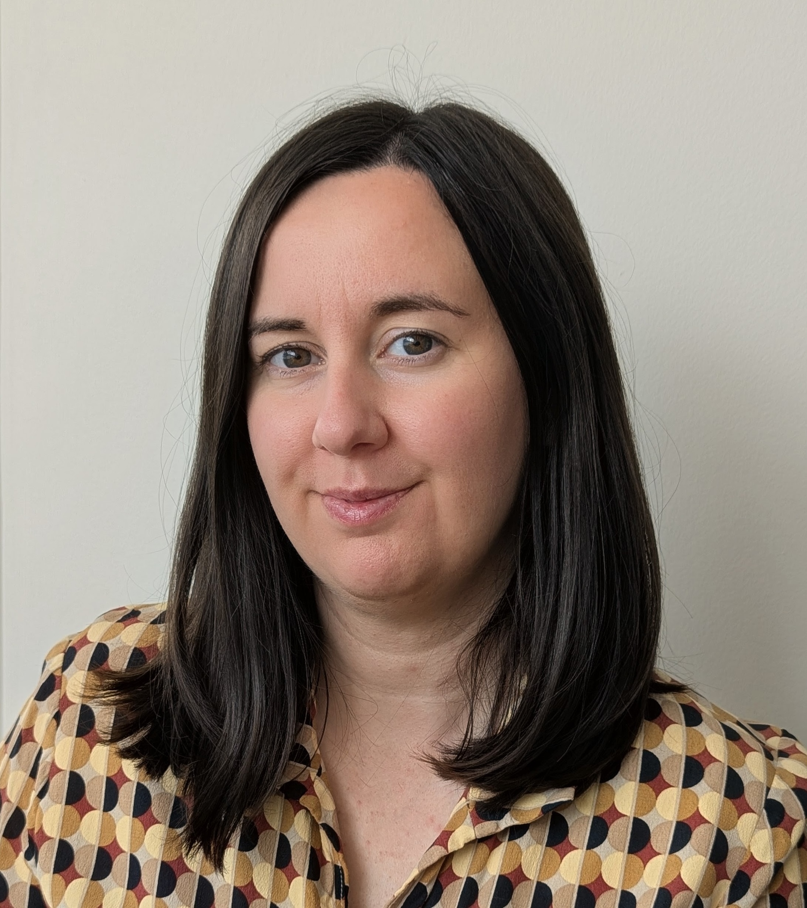
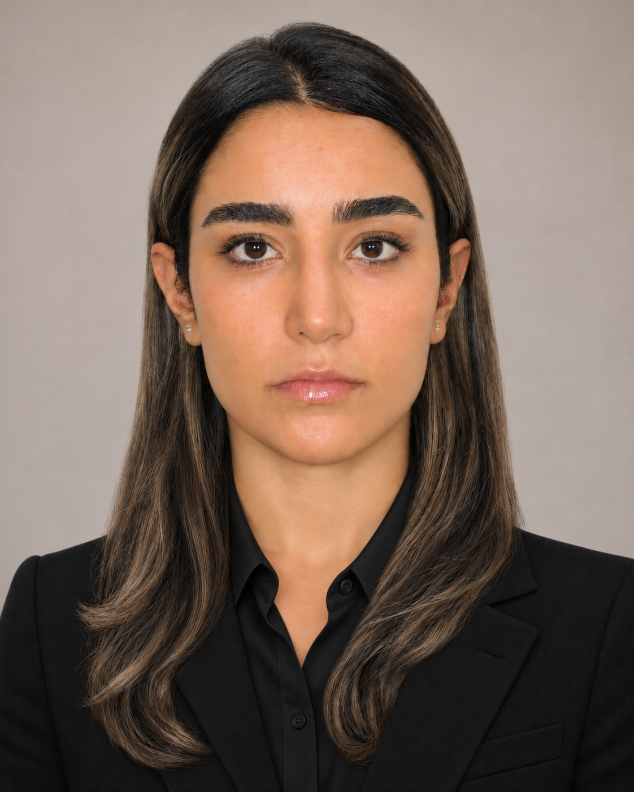

## About us

We're a small, interdisciplinary group working at the intersection of mathematical modelling, statistics, health services and public health. Many group members are part of SFU's [MAGPIE](https://www.sfu.ca/magpie.html) group (Mathematics, Genomics and Prediction in Infection and Evolution), [CORDS](https://www.sfu.ca/math/research/cords.html) (Centre for Operations Research and Decision Sciences) and [PIPPS](https://www.sfu.ca/pipps.html) (Pacific Institute on Pathogens, Pandemics and Society). Our work includes close partnership with health system collaborators, including colleagues at Vancouver Coastal Health through the VCH-SFU Embedded Research Program, the Squamish Nation's Kal’númet Primary Care Clinic and the Public Health Agency of Canada.

## PI

:::: card-grid
::: card

### Jessica Stockdale

[Read more here](about.qmd)
:::
::::

## Current members

:::::: card-grid
::: card

### Shab Molan

[PhD student]{.card-tag}

Shab's research centers on infectious disease epidemiology and genomic surveillance, combining phylogenetic methods with epidemiological data to understand pathogen transmission. She applies Bayesian phylodynamic tools and molecular clustering to reconstruct transmission networks from whole-genome sequencing data, particularly to evaluate vaccination programs and outbreak drivers.
:::

::: card

### Mina Moeini

[PhD student]{.card-tag}

Mina is a PhD student in the Department of Mathematics at SFU, with a Master's degree in Operations Research. Her research uses mathematical modeling and operations research methods to address healthcare challenges, focusing on health equity, homelessness, Indigenous healthcare access, and long-term care placement. She is passionate about creating meaningful social impact through research.
:::

::: card

### Jacob Umbach

[MSc student]{.card-tag}

Jacob is an MSc student studying Operations Research. His research involves patient journey mapping, modelling and data analytics to support better provision of wound care services for people experiencing multiple barriers to care in Vancouver.

 
:::
::::::

## Alumni

:::::: timeline-item
[2026]{.timeline-when}

::: person-entry
### Yingqi (Echo) He - BSc

Visualization for Indigenous primary care capacity modelling.

<strong>Next:</strong> Masters student, University of Toronto · <a href="https://www.linkedin.com/in/yingqi-he/">LinkedIn</a>

:::

::: person-entry
### Mohammed Faisal - BSc

Knowledge Mobilization Research Assistant for the VCH-SFU Embedded Research Program.

:::

::::::

:::::: timeline-item
[2025]{.timeline-when}

::: person-entry
### Niloufar Saeidi - MSc

Estimating serial intervals with epidemiological and genomic data.

<strong>Next:</strong> Data Scientist at BMO · <a href="https://www.linkedin.com/in/niloufar-saeidi/">LinkedIn</a>

:::

::: person-entry
### Minh Nguyen - BSc

Epidemiological modelling of the 1918 influenza pandemic in Vancouver.

<strong>Next:</strong> SFU undergraduate student · <a href="https://www.linkedin.com/in/le-tuan-minh-nguyen/">LinkedIn</a>

:::

::::::

::::: timeline-item
[2024]{.timeline-when}

::: person-entry
### Kunpeng (Andy) Zhang - BSc

Genomic epidemiology for Tuberculosis in Blantyre, Malawi.

<strong>Next:</strong> System Software Engineer intern at NVIDIA · <a href="https://www.linkedin.com/in/andy-zhang-sfu/">LinkedIn</a>

:::

:::::

:::::: timeline-item
[2023]{.timeline-when}

::: person-entry
### Vibhuti Gandhi - BSc

Machine learning and data collation for COVID-19 outbreak dynamics.

<strong>Next:</strong> Data Scientist at BCLC · <a href="https://www.linkedin.com/in/vibhuti-gandhi/">LinkedIn</a>

:::

::: person-entry
### Christopher Douglas - BSc

Developed an object-oriented genomic and epidemiological outbreak simulation package
:::

::::::

::::: timeline-item
[2022]{.timeline-when}

::: person-entry
### Cody Zhang

Developed a web-based simulation app for long-term care COVID-19 outbreaks.

<strong>Next:</strong> Database Administrator at Lululemon · <a href="https://www.linkedin.com/in/cody-zhang/">LinkedIn</a>

:::

:::::

