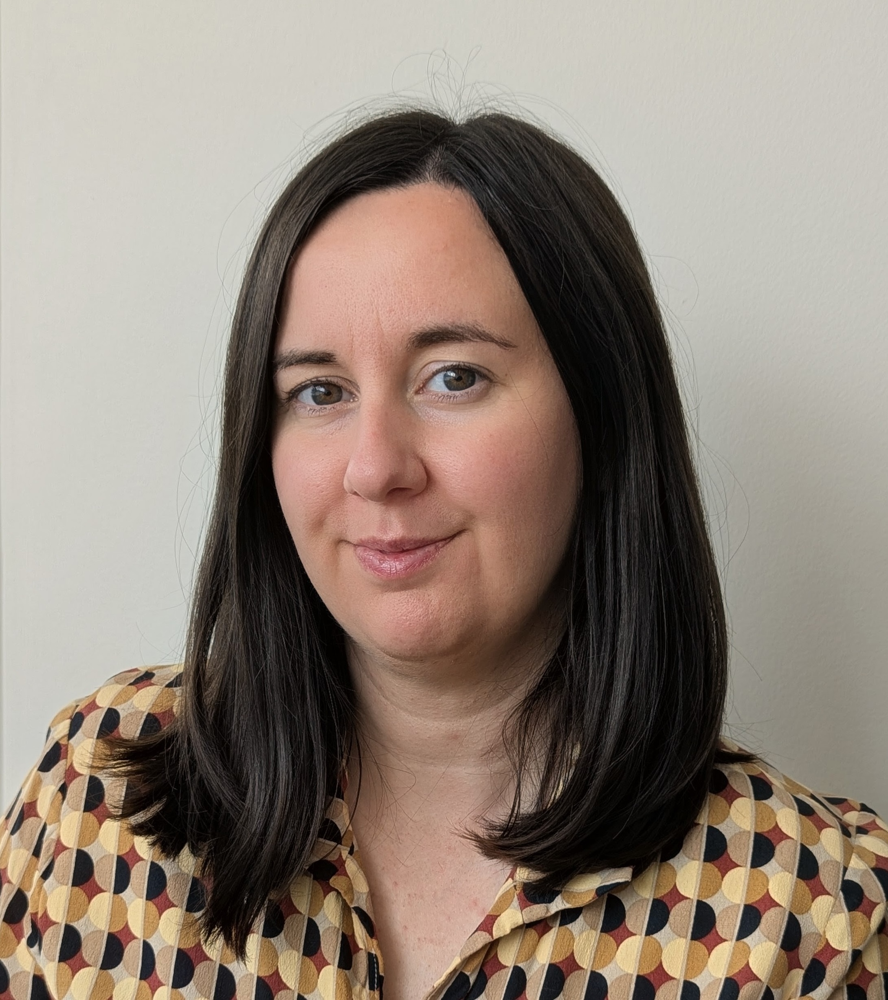

::::: hero-inner
::: hero-text
<p class="eyebrow">

Assistant Professor, Stephens Family School of Medicine, Simon Fraser University

</p>

# Jessica Stockdale

<p class="hero-lede">

My research uses mathematical modelling, statistics and data science to advance evidence-informed, equitable health care delivery and population health. My focuses are in primary care, community care, public health, and epidemiology.

</p>

```{=html}
<div class="hero-cta">
<a class="btn btn-primary rounded-pill" href="research.qmd" role="button">See my research</a>
<a class="btn btn-primary rounded-pill" href="contact.qmd" role="button">Get in touch</a>
</div>
```
:::

::: hero-photo
{alt="Portrait of Jessica Stockdale"}
:::
:::::

```{=html}
<div class="path-wrap" style="max-width:1500px;">
<svg viewBox="0 0 1500 240" width="1500" height="240" style="max-width:100%;height:auto;" xmlns="http://www.w3.org/2000/svg" role="img" aria-label="A winding path connecting four ideas: community, data, modelling, practice.">
  <path d="M110,120 C230,30 420,210 540,120 S760,30 970,120 S1290,210 1400,120" fill="none" stroke="#AE5B54" stroke-width="4" stroke-linecap="round" stroke-dasharray="4 22" />
  <circle cx="110" cy="120" r="8" fill="#C99A3E" />
  <circle cx="540" cy="120" r="8" fill="#C99A3E" />
  <circle cx="970" cy="120" r="8" fill="#C99A3E" />
  <circle cx="1400" cy="120" r="8" fill="#C99A3E" />
  <text class="path-caption" x="110" y="178" text-anchor="middle" fill="#58515C">community</text>
  <text class="path-caption" x="540" y="178" text-anchor="middle" fill="#58515C">data</text>
  <text class="path-caption" x="970" y="178" text-anchor="middle" fill="#58515C">modelling</text>
  <text class="path-caption" x="1400" y="178" text-anchor="middle" fill="#58515C">practice</text>
</svg>
</div>
```

## About me

I'm an Assistant Professor in the [Stephens Family School of Medicine](https://www.sfu.ca/medicine.html) at Simon Fraser University, and a member of the Department of Mathematics' [MAGPIE](https://www.sfu.ca/magpie.html) research group. My group uses mathematical, statistical, computational and data-driven methods to answer questions in health and healthcare. Current areas of focus include

1.  Organization and delivery of primary and community care,

2.  Public health challenges in urban populations,

3.  Transmission of infectious diseases and genomic epidemiology.

I am the academic co-lead of the [VCH–SFU Embedded Research Program](images/ERPProgramSummary2026.pdf), which places mathematical modelling and operations research capacity directly within Vancouver Coastal Health, working in areas from supported housing to wound care. Much of my research has been in the area of **mathematical epidemiology**, including modelling to support response to the COVID-19 pandemic. We're also interested in how mathematics can be combined with implementation science and **Learning Health Systems** thinking, to close the gap between research and practice.
