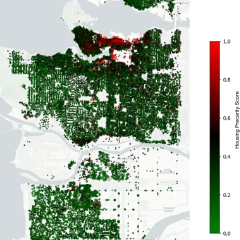
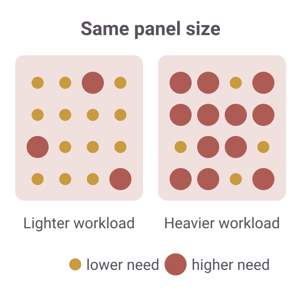
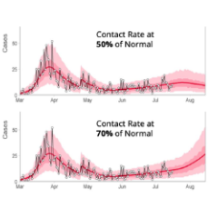
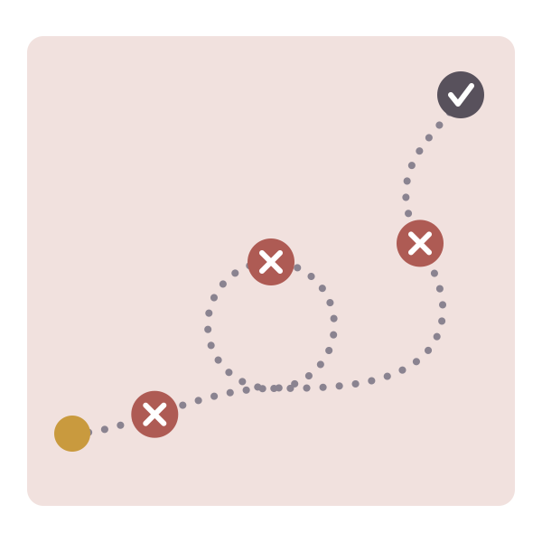
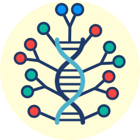
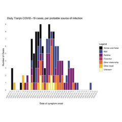
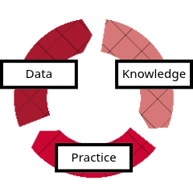

Read about some of our past and present projects

::: tag-filter
<button class="tag-filter-btn active" data-filter="all">
All
</button>
<button class="tag-filter-btn" data-filter="community-care">
Community care
</button>
<button class="tag-filter-btn" data-filter="urban-health">
Urban health
</button>
<button class="tag-filter-btn" data-filter="epi-models">
Epi models
</button>
<button class="tag-filter-btn" data-filter="other">
Other
</button>
:::

:::::::::: card-grid
::: {.card data-tags="urban-health community-care"}
 [Urban health]{.card-tag} [Community care]{.card-tag}

### Homelessness & supported housing

Working with Vancouver Coastal Health to improve identification of people experiencing homelessness using machine learning and inform supported housing planning and allocation with simulation modelling.
:::

::: {.card data-tags="community-care"}
 [Community care]{.card-tag}

### Primary care panel sizes

Evaluating panel size sustainability in various primary care settings, including care for marginalized and Indigenous populations. In partnership with the Squamish Nation's Kal’númet Primary Care Clinic, co-developing culturally-appropriate panel alternatives.
:::

::: {.card data-tags="epi-models"}
 [Epi models]{.card-tag}

### BC COVID-19 modelling

Modelling to support response to the COVID-19 pandemic in British Columbia, including population-level forecasts, epidemiological estimates, and evaluation of interventions such as physical distancing. [\[1\]](https://www.eurosurveillance.org/content/10.2807/1560-7917.ES.2021.26.40.2001204?crawler=true) [\[2\]](https://royalsocietypublishing.org/rsos/article/9/1/211710/96398/Quantifying-transmissibility-of-SARS-CoV-2-and) [\[3\]](https://www.sciencedirect.com/science/article/pii/S1755436521000141) [\[4\]](https://journals.plos.org/ploscompbiol/article?id=10.1371/journal.pcbi.1008274) [\[5\]](https://www.sciencedirect.com/science/article/pii/S0022519322003599)
:::

::: {.card data-tags="community-care urban-health"}
 [Community care]{.card-tag} [Urban health]{.card-tag}

### Community-based wound care strategies

Mapping the journeys of patients experiencing multiple barriers to wound care in Vancouver, and using simulation to evaluate interventions that improve access and outcomes and reduce costs.
:::

::: {.card data-tags="epi-models"}
 [Epi models]{.card-tag}

### Genomic epidemiology and disease transmission

Using pathogen genomic data to reconstruct transmission networks, understand outbreak dynamics, and design interventions, including for COVID-19, tuberculosis and influenza. [\[1\]](https://www.nature.com/articles/s41467-023-40544-y) [\[2\]](https://www.science.org/doi/full/10.1126/sciadv.abp9185) [\[3\]](https://www.microbiologyresearch.org/content/journal/mgen/10.1099/mgen.0.000450) [\[4\]](https://www.nature.com/articles/s41564-022-01233-6) [\[5\]](https://www.sciencedirect.com/science/article/pii/S2468042726000539)
:::

::: {.card data-tags="epi-models"}
 [Epi models]{.card-tag}

### Infectious disease - who and how

Developing modelling and statistical methods that help us understand how, when and among whom infectious diseases are spreading. [\[1\]](https://academic.oup.com/biostatistics/article/22/3/575/5663563) [\[2\]](https://elifesciences.org/articles/57149) [\[3\]](https://www.sciencedirect.com/science/article/pii/S1755436516300500) [\[4\]](https://pmc.ncbi.nlm.nih.gov/articles/PMC12464577/)
:::

::: {.card data-tags="other"}
 [Other]{.card-tag}

### Implementation of Embedded Research initiatives

Studying the implementation of embedded research initiatives, as an enabler of learning health system environments
:::
::::::::::

```{=html}
<script>
document.querySelectorAll('.tag-filter-btn').forEach(btn => {
  btn.addEventListener('click', () => {
    document.querySelectorAll('.tag-filter-btn').forEach(b => b.classList.remove('active'));
    btn.classList.add('active');
    const filter = btn.dataset.filter;
    document.querySelectorAll('.card').forEach(card => {
      const tags = (card.dataset.tags || '').split(' ');
      card.hidden = filter !== 'all' && !tags.includes(filter);
    });
  });
});
</script>
```
