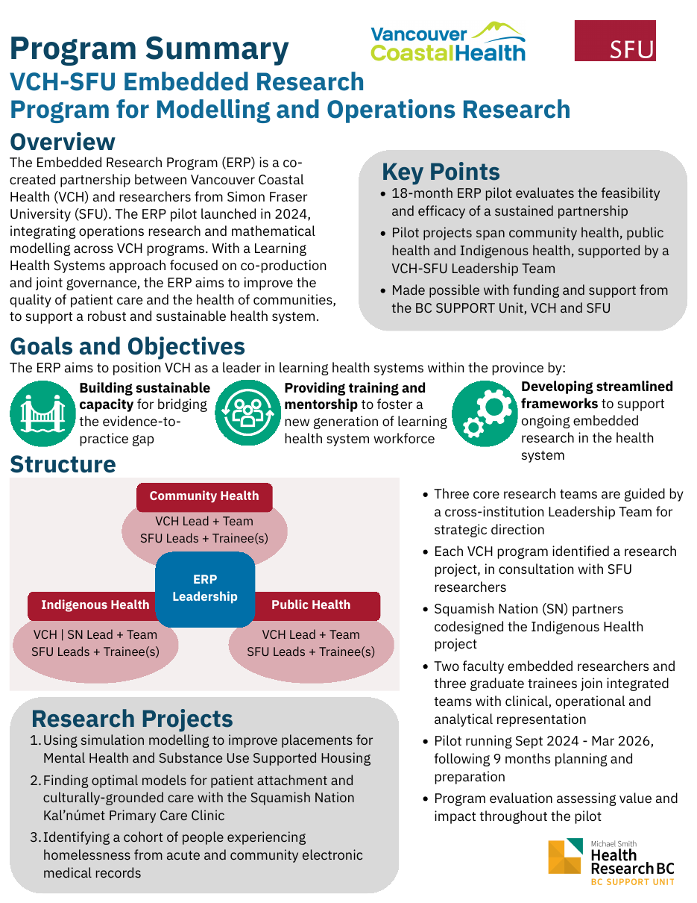

### VCH-SFU Embedded Research Program

::: resource-feature
```{=html}
<a href="images/ERPProgramSummary2026.pdf"></a>
```

[ERP Program Summary (2026)](images/ERPProgramSummary2026.pdf) — one-page overview of the Embedded Research Program pilot.
:::

### Equity, diversity & inclusion

-   [SFU EDI resources](https://www.sfu.ca/edi.html) — SFU's equity, diversity and inclusion resources and reports.
-   [Department of Mathematics EDI Advisory Group](https://www.sfu.ca/math/department/edi.html) — department EDI group and useful resources.
-   Lab EDI policy — coming soon.

### Code & software

-   [GitHub - jessicastockdale](https://github.com/jessicastockdale) — my GitHub profile.
-   [MAGPIE group GitHub](https://github.com/MAGPIE-SFU) — contains various repos from SFU's MAGPIE group.

::::::: {.card-grid .card-grid-2}
::: card
[Simulation]{.card-tag}

#### [`OOPidemic`](https://github.com/jessicastockdale/OOPidemic)

Object-oriented outbreak simulator, generating epidemiological and genomic data.
:::

::: card
[Genomic epidemiology]{.card-tag}

#### [`genomicSIs`](https://github.com/jessicastockdale/genomicSIs)

Estimate serial intervals using viral sequences.
:::

::: card
[Outbreak modelling]{.card-tag}

#### [`cr0eso`](https://sempwn.github.io/cr0eso/index.html)

Estimate R0 in multiple facility outbreaks with a Bayesian hierarchical compartmental model.
:::

::: card
[COVID-19 modelling]{.card-tag}

#### [`covidseir`](https://seananderson.github.io/covidseir/index.html)

Bayesian SEIR model focused on estimating effects of NPIs and making short-term case projections. Used for BC COVID-19 modelling.
:::
:::::::

### 
